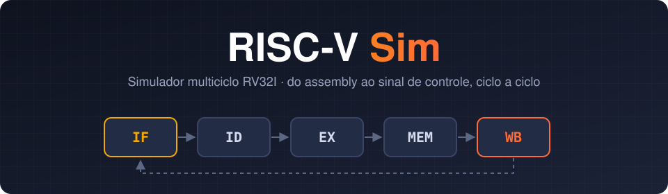
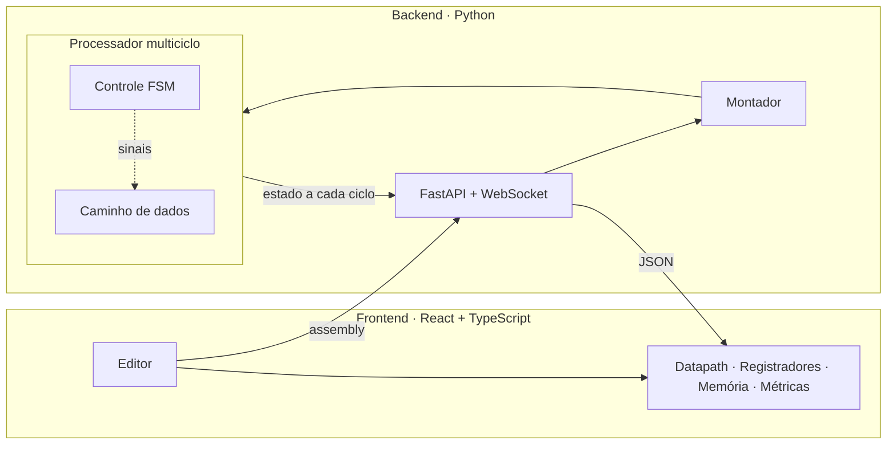
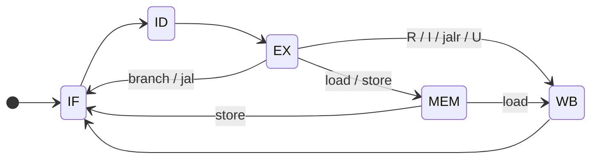

<div align="center">



<br/>


**Um simulador visual de processador RISC-V multiciclo.**<br/>
Escreva assembly, monte, e veja cada instrução atravessar o caminho de dados,<br/>
componente por componente, sinal por sinal, ciclo a ciclo.

[Funcionalidades](#-funcionalidades) ·
[Como rodar](#-como-rodar) ·
[Arquitetura](#-arquitetura) ·
[Montador](#-montador) ·
[Cavalês](#-cavalês) ·
[Programas](#-programas-de-teste) ·
[Equipe](#-equipe)

</div>

---

## 📖 Sobre

Trabalho da disciplina de **Arquitetura de Computadores**. O objetivo é
simular um processador **no nível dos componentes**, e não só interpretar
instruções: banco de registradores, ULA, gerador de imediatos,
multiplexadores, memória e uma unidade de controle que gera os sinais de
cada etapa.

O processador implementa o conjunto base de inteiros **RV32I** em uma
organização **multiciclo**: cada instrução passa por 3 a 5 etapas
(**IF → ID → EX → MEM → WB**), e cada etapa ocupa um ciclo de clock que você
pode acompanhar na tela.

<!-- Descomentar quando houver o GIF da interface em assets/demo.gif
<div align="center">
  
</div>
-->

## ✨ Funcionalidades

| | |
| --- | --- |
| 🧩 **Caminho de dados animado** | Diagrama do datapath com os componentes ativos acesos a cada ciclo |
| 🔍 **Estado interno completo** | Registradores x0–x31, PC, IR, A, B, ALUOut, MDR e sinais de controle |
| 🧮 **Montador integrado** | Duas passadas, rótulos, diretivas, pseudoinstruções e erros com número da linha |
| ⏯️ **Controle fino da execução** | Executar, pausar, reiniciar, passo por ciclo ou por instrução, velocidade ajustável |
| 🛑 **Breakpoints** | Clique na margem do editor e a simulação para quando o PC chegar lá |
| 🗂️ **Memória ao vivo** | Visualização da memória com destaque do endereço lido ou escrito |
| 📊 **Métricas** | Ciclos, instruções, CPI médio, acessos à memória e tempo de execução |
| 🐴 **Modo cavalo** | Programe em [cavalês](#-cavalês), o dialeto equino do montador |

## 🚀 Como rodar

**Pré-requisitos:** Python 3.11+ e Node.js 20+.

```bash
git clone https://github.com/Kronohdev/riscv-sim.git
cd riscv-sim
```

<details open>
<summary><b>Backend (Python)</b></summary>

```bash
cd backend
python -m venv .venv
source .venv/bin/activate        # Windows: .venv\Scripts\activate
pip install -e .
uvicorn riscv_sim.api.app:app
```

</details>

<details open>
<summary><b>Frontend (TypeScript)</b></summary>

```bash
cd frontend
npm install
npm run dev
```

Abra **http://localhost:5173**.

</details>

<details>
<summary><b>Rodar os testes</b></summary>

```bash
cd backend
pip install -e ".[dev]"
pytest
```

</details>

## 🏗️ Arquitetura

O software é dividido em um **núcleo de simulação em Python**, que não sabe
nada de interface, e um **frontend em TypeScript**, que só exibe o estado.
Os dois conversam por WebSocket: a cada ciclo, o backend envia um retrato
completo da máquina.



### Etapas e ciclos por instrução

| Etapa | Operação |
| --- | --- |
| **IF** | `IR ← Mem[PC]` · `PC ← PC + 4` |
| **ID** | `A ← Reg[rs1]` · `B ← Reg[rs2]` · `ALUOut ← PC + imm` |
| **EX** | operação da ULA, cálculo de endereço ou decisão do desvio |
| **MEM** | leitura ou escrita na memória |
| **WB** | escrita no registrador destino |

| Classe | Etapas | Ciclos |
| --- | --- | :---: |
| Branch, `jal`, `ecall` | IF · ID · EX | **3** |
| R, I, `jalr`, `lui`, `auipc`, store | IF · ID · EX · (MEM ou WB) | **4** |
| Load | IF · ID · EX · MEM · WB | **5** |



### Instruções suportadas

| Grupo | Instruções |
| --- | --- |
| Registrador (R) | `add` `sub` `and` `or` `xor` `sll` `srl` `sra` `slt` `sltu` |
| Imediato (I) | `addi` `andi` `ori` `xori` `slli` `srli` `srai` `slti` `sltiu` |
| Load | `lw` `lh` `lhu` `lb` `lbu` |
| Store | `sw` `sh` `sb` |
| Desvio (B) | `beq` `bne` `blt` `bge` `bltu` `bgeu` |
| Salto (J) | `jal` `jalr` |
| Superior (U) | `lui` `auipc` |
| Sistema | `ecall` |

### Mapa de memória

| Região | Início |
| --- | --- |
| `.text` | `0x0000_0000` |
| `.data` | `0x0000_2000` |
| Pilha (`sp` inicial) | `0x0000_FFF0` |

## 🧮 Montador

```asm
        .data
vet:    .word 5, -3, 12, 7          # dados
        .text
main:   la   t0, vet                # pseudoinstrução
        lw   t1, 0(t0)
        addi t1, t1, -1
        bnez t1, main
        ecall                       # fim
```

- Comentários com `#`, rótulos com `nome:`, espaçamento livre
- Registradores como `x0`–`x31` ou nomes ABI (`zero`, `ra`, `sp`, `t0`…)
- Números em decimal, `0x` hexadecimal ou `0b` binário
- Diretivas `.text` `.data` `.word` `.half` `.byte` `.space`
- Pseudoinstruções `li` `la` `mv` `not` `neg` `nop` `j` `jr` `ret` `call` `beqz` `bnez` `bgt` `ble`
- Erros com linha e mensagem, por exemplo `linha 7: registrador desconhecido 't9'`

## 🐴 Cavalês

Porque todo processador merece um pouco de galope. O **cavalês** é um
dialeto do montador com mnemônicos do mundo equino. Ele vira RV32I comum
antes da montagem, então o código de máquina é idêntico ao do assembly
tradicional.

<table>
<tr><th>RISC-V</th><th>Cavalês 🐴</th></tr>
<tr><td>

```asm
loop:
    sw   t1, 0(t0)
    add  t4, t1, t2
    mv   t1, t2
    mv   t2, t4
    addi t0, t0, 4
    addi t3, t3, -1
    bnez t3, loop
    ecall
```

</td><td>

```asm
loop:
    encocheira   potro1, 0(potro0)
    cruza        potro4, potro1, potro2
    muda_de_baia potro1, potro2
    muda_de_baia potro2, potro4
    da_feno      potro0, potro0, 4
    da_feno      potro3, potro3, -1
    segue_trote  potro3, loop
    relincha
```

</td></tr>
</table>

| Cavalês | RISC-V | | Cavalês | RISC-V |
| --- | --- | --- | --- | --- |
| `cruza` | `add` | | `galopa` | `jal` |
| `apeia` | `sub` | | `trota` | `j` |
| `da_feno` | `addi` | | `volta_pra_baia` | `ret` |
| `pasta` | `lw` | | `emparelha` | `beq` |
| `encocheira` | `sw` | | `empacou` | `beqz` |
| `ferra` | `li` | | `segue_trote` | `bnez` |
| `empina` | `sll` | | `cochila` | `nop` |
| `escoiceia` | `srl` | | `relincha` | `ecall` |

Registradores: `pangare` (x0, sempre zero), `rastro` (ra), `estabulo` (sp),
`potro0`–`6` (t), `egua0`–`11` (s), `alazao0`–`7` (a).

## 🧪 Programas de teste

| # | Programa | Demonstra | Resultado esperado |
| :---: | --- | --- | --- |
| 1 | [`01_aritmetica.s`](programs/01_aritmetica.s) | `lw`, `add`, `sub`, `sw` | `soma = 42`, `dif = 8` |
| 2 | [`02_laco_soma.s`](programs/02_laco_soma.s) | laço com `blt` | `1 + … + 10 = 55` |
| 3 | [`03_fibonacci.s`](programs/03_fibonacci.s) | laço e vetor | `0, 1, 1, 2, …, 610` |
| 4 | [`04_subrotina.s`](programs/04_subrotina.s) | `jal` / `jalr` | `6 × 7 = 42` |
| 5 | [`05_vetor.s`](programs/05_vetor.s) | `lw` com deslocamento, `bge` com sinal | `soma = 26`, `max = 12` |
| 6 | [`06_fibonacci.cav`](programs/06_fibonacci.cav) | cavalês 🐴 | igual ao programa 3 |

O cabeçalho de cada arquivo traz a entrada, o resultado esperado e o estado
final dos registradores.

## 📁 Estrutura

```text
riscv-sim/
├── backend/
│   └── riscv_sim/
│       ├── core/        # PC, registradores, ULA, imediatos, memória, controle
│       ├── assembler/   # montador de duas passadas + cavalês
│       └── api/         # FastAPI + WebSocket
├── frontend/
│   └── src/             # React: editor, datapath, painéis, controles
├── programs/            # programas de teste
└── docs/                # arquitetura, contrato da API, relatório
```

## 👥 Equipe

<table>
  <tr>
    <td align="center"><b>Pedro Leite</b><br/><sub>Núcleo do processador</sub></td>
    <td align="center"><b>Estrella</b><br/><sub>Montador e API</sub></td>
    <td align="center"><b>Gabriel</b><br/><sub>Interface</sub></td>
  </tr>
</table>

## 📚 Referências

- D. Patterson e J. Hennessy, *Computer Organization and Design — RISC-V Edition*
- [The RISC-V Instruction Set Manual, Volume I: Unprivileged ISA](https://riscv.org/technical/specifications/)
- [RARS — RISC-V Assembler and Runtime Simulator](https://github.com/TheThirtyFive/rars)

---

<div align="center">
<sub>Feito para a disciplina de Arquitetura de Computadores · horses don't stop, they keep going 🐎</sub>
</div>
